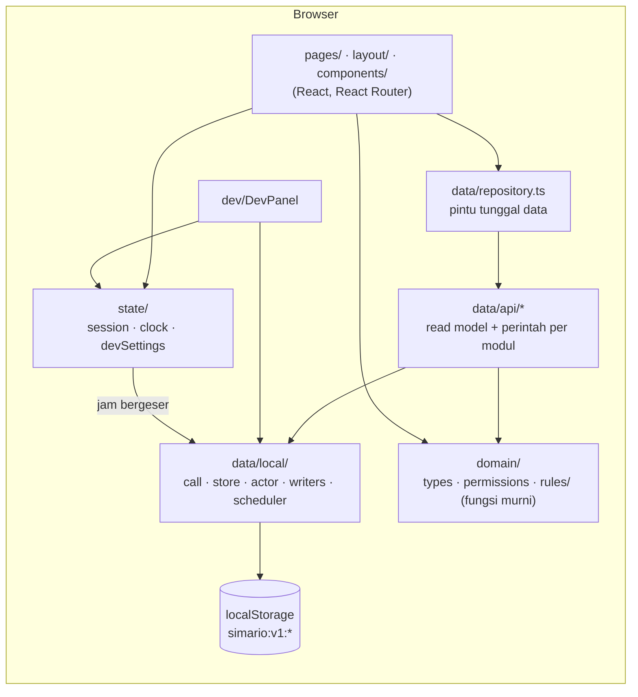
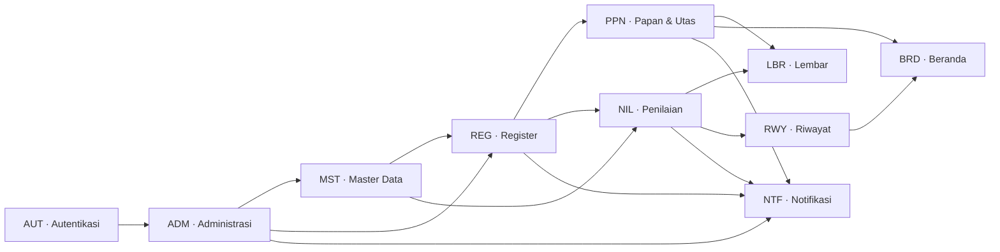
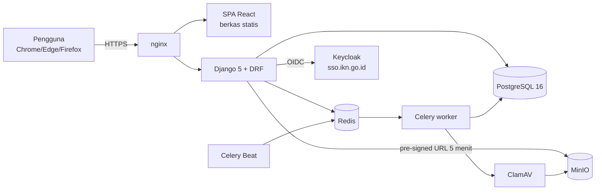
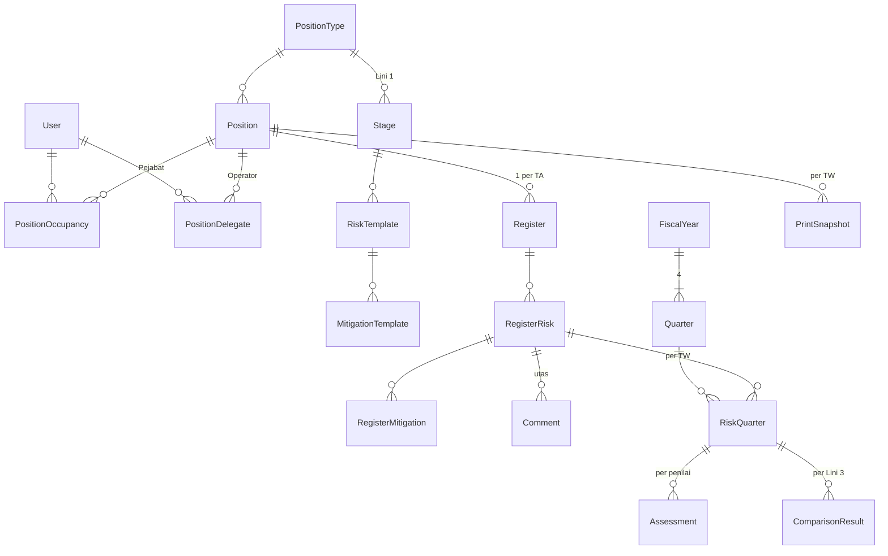

# 00 — Arsitektur SIMARIO

> Status dokumen: 21 Okt 2026 · mengacu ke PRD v2.9 (`docs/PRD_SIMARIO_v2.9.md`) dan kode di `frontend/` per komit `7bebb66`.
> Bila dokumen ini berbeda dari PRD, **PRD menang**; bila berbeda dari kode, kode adalah keadaan sebenarnya dan dokumen ini perlu diperbarui.

## 1. Ringkasan

SIMARIO (Sistem Informasi Mitigasi Risiko Otorita IKN) adalah catatan koordinasi dan kepatuhan untuk model tiga lini: register risiko tahunan per jabatan Lini 1, utas diskusi per risiko, penilaian triwulan Lini 1 dan Lini 3 yang dibandingkan secara buta, lalu Lembar Komunikasi Tiga Lini dan Lembar Mutu yang diturunkan otomatis (PRD §1.2).

Repositori ini saat ini berisi **prototipe frontend saja**:

| Bagian | Keadaan sekarang | Target produksi (PRD §2.1) |
|---|---|---|
| Frontend | ✅ React 18 + Vite + TypeScript, semua modul PRD | Sama (kode dapat dipakai ulang) |
| Backend / API | ⬜ **Belum ada.** Perannya disimulasikan di browser (`frontend/src/data/`) | Django 5 + Django REST Framework |
| Basis data | `localStorage` browser, satu kunci per koleksi (`simario:v1:*`) | PostgreSQL 16 |
| Tugas terjadwal | Evaluator di browser (`data/local/scheduler.ts`) | Celery + Redis, Celery Beat |
| Penyimpanan berkas | Hanya metadata; isi berkas tidak disimpan | MinIO + pemindaian ClamAV |
| Autentikasi | Pemilih persona + akun lokal dari seed | Keycloak (OIDC) realm "Otorita IKN", akun lokal sebagai cadangan |
| Penyebaran | Netlify, SPA statis (`netlify.toml`) | Docker Compose di belakang nginx, staging + produksi, lingkungan internal OIKN |

Detail tiap sisi: [01_backend.md](01_backend.md), [02_frontend.md](02_frontend.md), kontrak antarmuka: [03_api_contract.md](03_api_contract.md).

## 2. Arsitektur saat ini (prototipe)

Alur satu permintaan (contoh: Pejabat menuntaskan penilaian):

1. Halaman memanggil `assessmentApi.finalise(...)` dari `@/data/repository`.
2. `call()` (`data/local/call.ts`) menambahkan latensi 150–400 ms, simulasi luring, dan "gagalkan panggilan berikutnya" dari DevPanel — pengganti jaringan.
3. Fungsi di `data/api/assessment.ts` memeriksa izin dan holding lewat `domain/rules/access.ts` (`checkAction`, `requireActor`), menjalankan aturan bisnis murni dari `domain/rules/`, lalu menulis lewat `mutateDb()` (immer).
4. Dalam resep mutasi yang sama ditulis `AuditLog` (`writeAudit`, hanya tambah) dan `Notification` idempoten (`writeNotification`, per `eventKey`).
5. `store.ts` menyimpan koleksi yang berubah ke `localStorage` dan menaikkan `version`; setiap `useQuery` membaca ulang.
6. Tugas terjadwal (`runScheduledTasks`) berjalan saat aplikasi mulai, setiap tanggal simulasi bergeser, dan setelah event penuntasan.

### 2.1 Lapisan dan tanggung jawab

| Lapisan | Folder | Isi | Aturan |
|---|---|---|---|
| Domain | `frontend/src/domain/` | `types.ts` (entitas PRD §2.8.1, camelCase), `permissions.ts` (26 izin FR-ADM-002), `calendar.ts`, `scoreBands.ts`, `rules/*` | Fungsi murni, tanpa React, tanpa `new Date()`; diuji unit |
| Data | `frontend/src/data/` | `repository.ts`, `db.ts` (36 koleksi), `api/*` (12 modul), `local/*`, `seed/*` | Satu-satunya tempat yang menulis data; visibilitas VIS diterapkan di read model |
| State | `frontend/src/state/` | Sesi (persona, jabatan aktif, tampilan peran, lockout), jam simulasi, setelan dev, `useAuth` | Disimpan di `localStorage` di luar awalan `simario:v1:` |
| Tata letak | `frontend/src/layout/` | AppShell, Sidebar, Topbar, Workspace, nav, penjaga izin | Batas sesi tidak aktif ada di AppShell |
| Halaman | `frontend/src/pages/` | 11 modul halaman | Tidak menyentuh `localStorage`; menerima data yang sudah difilter |
| Komponen | `frontend/src/components/` | Pustaka UI dengan nama sama seperti di `Simario.pen` | Hanya token CSS (`var(--…)`) |
| Dev | `frontend/src/dev/` | DevPanel, galeri komponen `/_komponen` | Khusus prototipe |

### 2.2 Modul fungsional

Kode modul mengikuti PRD §1.7. Ketergantungan diambil dari bagian "Dependencies" tiap modul PRD.

| Modul | Rute utama | Read model / perintah | Aturan murni |
|---|---|---|---|
| AUT | `/login`, `/ganti-kata-sandi` | `authApi` (`repository.ts`) | `rules/access.ts` |
| BRD | `/`, `/jabatan`, `/pantauan` | `homeApi` (`api/home.ts`) | `rules/board.ts`, `rules/sheets.ts` |
| REG | `/jabatan/:jid/register/:ta` | `registerApi` (`api/register.ts`, read model `api/registerView.ts`) | `rules/register.ts` |
| PPN | `/jabatan/:jid/papan/:ta[/risiko/:rid]` | `boardApi`, `threadApi` | `rules/board.ts` |
| NIL | `/jabatan/:jid/penilaian/:ta/:tw`, `/penilaian` | `assessmentApi`; `local/comparisons.ts` | `rules/assessment.ts`, `rules/comparison.ts` |
| RWY | `/jabatan/:jid/riwayat` | `historyApi` | `rules/sheets.ts` |
| LBR | `/jabatan/:jid/lembar/:ta/:tw` | `sheetApi` | `rules/sheetPayload.ts`, `rules/sheets.ts` |
| MST | `/master/*` | `masterApi` | `scoreBands.ts` |
| NTF | lonceng, `/notifikasi` | `notificationApi`; `local/reminders.ts` | — |
| ADM | `/pengaturan/*`, `/jabatan-saya`, `/metrik`, `/jejak-audit` | `adminApi`, `calendarApi`, `importApi`, `insightsApi` | `calendar.ts`, `rules/access.ts` |

## 3. Arsitektur target (produksi)

Belum dibangun. Gambaran di bawah diturunkan dari PRD §2.1, §2.3 (NFR), dan Lampiran C.

Pemetaan komponen prototipe → produksi:

| Prototipe | Produksi | Catatan |
|---|---|---|
| `data/local/call.ts` | Klien HTTP (fetch) ke DRF | Antarmuka `repository.ts` tetap; hanya implementasinya diganti |
| `data/local/store.ts` + `localStorage` | PostgreSQL via Django ORM | 36 koleksi ≈ tabel entitas PRD §2.8.1 |
| `requireActor` / `checkAction` | Permission class DRF + pemeriksaan holding di service | Aturan sama: izin → holding/penugasan → Pejabat (RB-ADM-001) |
| Read model `buildBoard`, `buildAssessment`, … | Serializer/selector DRF | VIS-1…9 wajib di serializer (PRD §2.7, INV-16/17) |
| `writeAudit` | Tabel `AuditLog` + trigger penolak UPDATE/DELETE | INV-6 |
| `writeNotification` (`eventKey`) | Layanan notifikasi idempoten | FR-NTF aturan umum |
| `scheduler.ts` (dipicu jam simulasi) | Celery Beat + task idempoten | Lihat [01_backend.md §5](01_backend.md#5-tugas-terjadwal) |
| `state/clock.ts` (tanggal simulasi) | Jam server | DevPanel tidak ada di produksi |
| Pemilih persona / akun lokal seed | Keycloak OIDC, akun lokal ber-hash | FR-AUT-001…005 |
| `setTimeout` pemindaian 2 detik | ClamAV sebelum berkas dapat diunduh | NFR-010, INV-10 |
| Event `storage` antar-tab | Polling 30 detik di halaman utas | NFR-015 |
| `data/seed/*` + `docs/seed/*.json` | Fixture / management command Django | FR-MST-010 |

## 4. Prinsip arsitektur yang wajib dipertahankan

Prinsip ini berlaku untuk prototipe dan backend yang akan datang (CLAUDE.md §4–§6, PRD §2.6–§2.8):

1. **Satu pintu data.** Halaman hanya memakai `@/data/repository`. Semua penulisan lewat namespace `*Api`. (Lihat utang teknis U-01 di [04_risk_and_debt.md](04_risk_and_debt.md): sebagian halaman masih *membaca* store langsung.)
2. **Izin = kemampuan; holding/penugasan = objek; Pejabat = tindakan akhir** (RB-ADM-001, INV-12, INV-24, INV-25). Logika memeriksa kode izin 1–26, tidak pernah nama peran (RB-ADM-002).
3. **Visibilitas di selector/serializer**, bukan di JSX: VIS-1 buta, VIS-3 konfidensial, VIS-5/VIS-9 direktorat terlambat, VIS-7 tampilan turunan netral-pembaca, VIS-8 redaksi audit. Angka skor tidak pernah dikirim ke tampilan pengguna kecuali Skala Penilaian, ekspor CSV metrik, dan impor (PRD v2.8).
4. **Validasi hanya memblokir gerbang struktural** (§2.6, BR-013); penilaian diri tidak pernah diblokir; tombol yang belum lengkap tetap aktif dan mendaftar kekurangannya.
5. **Tidak retroaktif** (§2.8.3): uraian disnapshot, uraian terbit tidak berubah (INV-7), pita skor berversi per triwulan, penilaian yang sudah dibuka beku (INV-18), snapshot cetak tidak berubah (INV-22).
6. **Nonaktifkan, jangan hapus**; jejak audit hanya-tambah.
7. **Tenggat menandai, tidak mengunci** (RB-ADM-005), kecuali pembekuan perbandingan dan batas arsip.
8. **Waktu dari satu sumber.** Aturan bisnis memakai `now()` dari `state/clock`, tidak pernah `new Date()`, agar skenario dapat digeser dan nanti diganti jam server.
9. **Tugas terjadwal idempoten**: aman dijalankan berulang kali pada jam yang sama.

## 5. Model data (ringkas)

Entitas lengkap ada di PRD §2.8.1; tipe TypeScript-nya di `frontend/src/domain/types.ts`; koleksi prototipe di `frontend/src/data/db.ts`. Kelompok besar:

Perbedaan bentuk data prototipe terhadap PRD dicatat di [01_backend.md §4](01_backend.md#4-model-data-prd-vs-prototipe).

## 6. Keputusan arsitektur yang tercatat

| # | Keputusan | Alasan | Sumber |
|---|---|---|---|
| A-1 | Prototipe tanpa backend, data di `localStorage` | Demo dan uji pengguna tanpa infrastruktur | CLAUDE.md §1 |
| A-2 | Semua akses data lewat `repository.ts` yang asinkron | Agar implementasi lokal bisa diganti panggilan Django REST | CLAUDE.md §4 |
| A-3 | Tanggal simulasi menggantikan `new Date()` | Skenario TW I–IV dapat didemokan dalam satu sesi | CLAUDE.md §5 |
| A-4 | Template risiko hanya dari `docs/seed/template_risiko_rapim.json`, kunci stabil `code` | Data referensi final (FR-MST-010, OQ-6) | CLAUDE.md §2, §5 |
| A-5 | Satu breakpoint 900 px; tabel jadi kartu, tanpa gulir horizontal | PRD §2.2 | PRD §2.2 |
| A-6 | Token desain dihasilkan dari `Simario.pen`, bukan ditulis tangan | Satu sumber gaya | CLAUDE.md §7a |
| A-7 | Penilaian dengan pilihan kalimat; skor numerik disimpan, tidak ditampilkan | Keputusan pengguna 13 Okt 2026 | PRD v2.8 |
| A-8 | Isian Data Umum "Tujuan" opsional dan nonaktif secara bawaan (`objectiveEnabled`) | Keputusan pengguna; **berbeda dari PRD** | CLAUDE.md Tahap 10 |
| A-9 | Sidebar dapat diciutkan menjadi rel 72 px; konten melebar hingga 1368 px | PRD v2.9 | PRD §1.8.1, §2.2 |
| A-10 | Penyebaran demo di Netlify sebagai SPA statis dengan `noindex` | Berbagi prototipe; data fiktif saja | `netlify.toml` |

## 7. Dokumen terkait

| Dokumen | Isi |
|---|---|
| [01_backend.md](01_backend.md) | Status backend (belum ada), rancangan target, model data, tugas terjadwal |
| [02_frontend.md](02_frontend.md) | Struktur kode frontend, pola halaman, komponen, gaya, aksesibilitas |
| [03_api_contract.md](03_api_contract.md) | Kontrak `repository.ts` per namespace + usulan endpoint REST |
| [04_risk_and_debt.md](04_risk_and_debt.md) | Risiko produk/teknis dan utang teknis |
| [05_local_dev_and_testing.md](05_local_dev_and_testing.md) | Menjalankan lokal, DevPanel, pengujian, verifikasi visual, rilis |
| [06_user_stories.md](06_user_stories.md) | 71 user story PRD dengan status implementasi dan cara mencobanya |
| [PRD_SIMARIO_v2.9.md](PRD_SIMARIO_v2.9.md) | Sumber kebenaran perilaku |
| [DesignSystem_SIMARIO.md](DesignSystem_SIMARIO.md) | Warna, tipografi, komponen |
