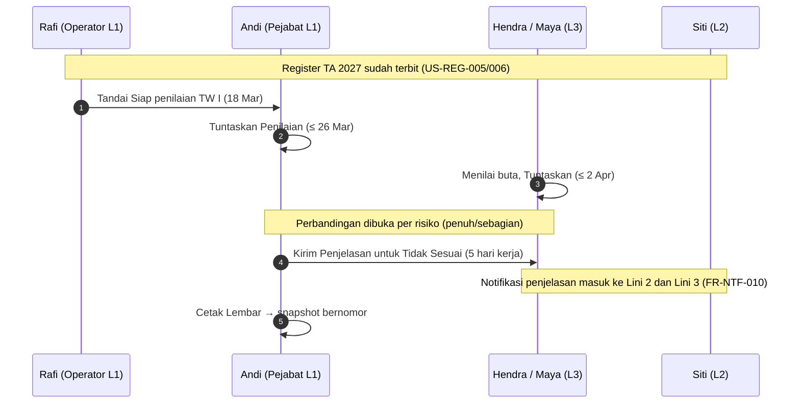

# 06 — User Story

> Status dokumen: 21 Okt 2026 · PRD v2.9 · kode `frontend/` per komit `7bebb66`.
> Sumber: tabel "User Stories" tiap modul PRD (§3.1–§12.1), diterjemahkan ke Bahasa Indonesia. Bila terjemahan berbeda makna, **teks PRD (bahasa Inggris) yang berlaku**. Kriteria penerimaan tidak disalin di sini — lihat FR yang dirujuk.

## 1. Cara membaca

`63af3d9c-facf-5af1-b1e4-1adfeb4ef9a3` di tautan adalah id PPK A-1 pada data demo backend (uuid5 dari id prototipe `pos-ppk-a1`); tautan demo `?sebagai=usr-andi` tetap memakai id persona prototipe.

| Simbol | Arti |
|---|---|
| ✅ | Berjalan di prototipe (data lokal, aturan bisnis lengkap) |
| 🟨 | Berjalan sebagian atau disimulasikan dengan batasan yang disebutkan |
| ⬜ | Belum ada |

Semua status berlaku untuk **prototipe frontend**. Untuk produksi, seluruh cerita masih menunggu backend ([01_backend.md](01_backend.md), R-01 di [04_risk_and_debt.md](04_risk_and_debt.md)).

Ringkasan: **71 cerita** — 66 ✅, 5 🟨, 0 ⬜.

Kolom "Coba" memakai id persona dan parameter URL dari [05_local_dev_and_testing.md §3–4](05_local_dev_and_testing.md#3-masuk-dan-persona). Tanpa `waktu`, tanggal simulasi bawaan adalah 6 Apr 2027 09.00 (hasil TW I sudah dibuka).

### Aktor

| Aktor PRD | Persona contoh |
|---|---|
| Lini 1 — Pejabat | Andi Wirawan (PPK A-1), Hadi Susanto (KPA Satker A), Dimas Prasetyo (Pengisi Pokja 03) |
| Lini 1 — Operator | Rafi Ananda (PPK A-1) |
| Lini 1 — anggota Pokja bukan Pengisi | Ratna Sari |
| Lini 2 | Siti Rahmawati (Penanggung Jawab Pemantauan), Lestari Wulandari (Operator UKPBJ) |
| Lini 3 | Hendra Gunawan (Direktorat Kepatuhan), Maya Kusuma (Direktorat Pengawasan dan Audit Internal) |
| Pembaca dalam cakupan, bukan peserta | Dewi Anggraini (cakupan Unit DDKB) |
| Pengelola Master Data | Nur Aini |
| Superadmin | Admin DKB |

## 2. Autentikasi (AUT)

| ID | Sebagai … saya ingin … | FR | Status | Coba |
|---|---|---|---|---|
| US-AUT-001 | Sebagai pengguna, saya ingin masuk dengan akun Otorita IKN yang sudah ada agar tidak perlu mengingat kata sandi lain | FR-AUT-001, 006 | 🟨 SSO lewat Keycloak lokal (realm `otorita-ikn`, cocok lewat NIP); `sso.ikn.go.id` menunggu akses | `/login` → "Masuk dengan Akun Otorita IKN" → NIP persona + `simario-demo` |
| US-AUT-002 | Sebagai pengguna tanpa entri di realm, saya ingin akun lokal agar celah SSO tidak mengunci saya | FR-AUT-002 | ✅ | `/login` → "Masuk dengan akun lokal", NIP Admin DKB; 5× salah → terkunci 15 menit |
| US-AUT-003 | Sebagai pengguna akun lokal, saya ingin dipaksa mengganti kata sandi awal | FR-AUT-003, 004, 005 | ✅ | Masuk sebagai Lestari → `/ganti-kata-sandi` tanpa sidebar |
| US-AUT-004 | Sebagai pengguna dengan lebih dari satu peran, saya ingin mengganti tampilan peran agar menu sesuai pekerjaan saya | FR-AUT-007 | ✅ (tidak ada persona seed dengan > 1 tampilan peran, U-17) | Admin DKB memberi Andi peran manual Pengelola Master Data → menu ⋯ Andi |
| US-AUT-005 | Sebagai pengguna yang bekerja untuk beberapa jabatan, saya ingin mengganti jabatan yang sedang saya kerjakan | FR-AUT-009 | ✅ | `?sebagai=usr-dimas` → kartu "JABATAN AKTIF" |

## 3. Beranda (BRD)

| ID | Sebagai … saya ingin … | FR | Status | Coba |
|---|---|---|---|---|
| US-BRD-001 | Sebagai Lini 1, saya ingin melihat setiap penilaian yang masih menjadi kewajiban saya, dari TA mana pun, dan sejauh mana kemajuannya | FR-BRD-001 | ✅ | `?sebagai=usr-andi&waktu=2027-03-18T09:00&data=sesuai` |
| US-BRD-002 | Sebagai Lini 1, saya ingin daftar hal yang perlu saya tindak sekarang | FR-BRD-002 | ✅ | `?sebagai=usr-andi` (penjelasan menunggu) |
| US-BRD-003 | Sebagai Lini 1, saya ingin melihat hasil triwulan lalu sekilas | FR-BRD-003, 004 | ✅ | Andi → kartu Lembar Mutu mini TW I |
| US-BRD-004 | Sebagai Lini 2, saya ingin melihat jabatan yang saya koordinasikan dan di mana keadaannya sepi | FR-BRD-005, 011 | ✅ | `?sebagai=usr-siti` → `/` dan `/pantauan` |
| US-BRD-005 | Sebagai Lini 3, saya ingin antrean penilaian direktorat saya dan risiko yang perlu perhatian | FR-BRD-006, 007 | ✅ | `?sebagai=usr-hendra` |
| US-BRD-006 | Sebagai Superadmin, saya ingin melihat celah konfigurasi sebelum menjadi masalah pengguna | FR-BRD-008 | ✅ | `?sebagai=usr-admin` |
| US-BRD-007 | Sebagai peserta, saya ingin melihat aktivitas terbaru di utas yang saya ikuti | FR-BRD-009 | ✅ | Andi → kartu aktivitas terbaru |

## 4. Register (REG)

B3: semua cerita REG berjalan di backend (view per pembaca, terbit, tambahan, nonaktif, salin, usulan).

| ID | Sebagai … saya ingin … | FR | Status | Coba |
|---|---|---|---|---|
| US-REG-001 | Sebagai Lini 1, saya ingin memilih risiko dan mitigasi dari daftar yang sudah disiapkan untuk setiap tahap saya | FR-REG-002, 003 | ✅ | `?sebagai=usr-hadi` → Register TA 2027 |
| US-REG-002 | Sebagai Lini 1, saya ingin memulai tahun ini dari register tahun lalu | FR-REG-009, FR-BRD-003 | ✅ | Hadi → "Salin dari TA 2026" + ringkasan salin |
| US-REG-003 | Sebagai Lini 1, saya ingin menambah risiko atau mitigasi sendiri bila daftar tidak cocok | FR-REG-003, 004 | ✅ | "+ Risiko sendiri" / "+ Mitigasi sendiri"; setelah terbit muncul di `/master/usulan` |
| US-REG-004 | Sebagai Lini 1, saya ingin menyatakan bahwa sebuah tahap atau jenis risiko tidak berlaku tahun ini, dengan alasan | FR-REG-002, 005 | ✅ | "Tahap ini tidak relevan tahun ini" / "Tidak ada risiko pada jenis ini" |
| US-REG-005 | Sebagai Operator, saya ingin menyiapkan register dan memberi tahu Pejabat bahwa sudah siap | FR-REG-006, FR-NTF-001 | ✅ | `?sebagai=usr-rafi` → "Tandai Siap Diterbitkan" |
| US-REG-006 | Sebagai Pejabat, saya ingin menerbitkan register agar tampil di papan | FR-REG-007, FR-NTF-002 | ✅ | Andi → "Terbitkan Register"; gerbang struktural mendaftar celah |
| US-REG-007 | Sebagai Lini 1, saya ingin menambah risiko di tengah tahun tanpa menerbitkan ulang semuanya | FR-REG-008 | ✅ | Andi → strip "Belum diterbitkan" → "Terbitkan Tambahan" |
| US-REG-008 | Sebagai Lini 1, saya ingin memensiunkan risiko yang tidak berlaku lagi dengan riwayat tetap tersimpan | FR-REG-010 | ✅ | Andi → menu kartu terbit → "Nonaktifkan" (alasan wajib) |

## 5. Papan Risiko & Utas (PPN)

B4: semua cerita PPN berjalan di backend, termasuk unggahan sungguhan, pemindaian virus, dan polling 30 detik.

| ID | Sebagai … saya ingin … | FR | Status | Coba |
|---|---|---|---|---|
| US-PPN-001 | Sebagai peserta, saya ingin semua risiko satu jabatan ada di satu papan, dapat difilter, dengan apa yang berubah baru-baru ini | FR-PPN-001 | ✅ | `/jabatan/63af3d9c-facf-5af1-b1e4-1adfeb4ef9a3/papan/2027` |
| US-PPN-002 | Sebagai Lini 1, saya ingin mencatat apa yang sudah saya lakukan pada risiko atau mitigasi, dengan foto dan dokumen | FR-PPN-003, 004, 005 | 🟨 Langkah lengkap; isi berkas tidak disimpan (placeholder, U-08) | Andi → "Tandai sebagai Langkah" + lampiran |
| US-PPN-003 | Sebagai Lini 2, saya ingin memberi solusi dan saran pada risiko atau mitigasi tertentu | FR-PPN-003, RB-PPN-002 | ✅ | `?sebagai=usr-siti` → utas PPK A-1 |
| US-PPN-004 | Sebagai Lini 3, saya ingin berkomentar dan melampirkan bahan yang hanya boleh dilihat Lini 3 | FR-PPN-006, VIS-3 | ✅ | Hendra → "Konfidensial" per berkas; Andi melihat "1 lampiran konfidensial" |
| US-PPN-005 | Sebagai peserta, saya ingin menyebut seseorang agar ia diberi tahu | FR-PPN-007, FR-NTF-003 | ✅ | Ketik "@" di composer (hanya peserta yang ditawarkan) |
| US-PPN-006 | Sebagai peserta, saya ingin melihat sekilas risiko mana yang belum ada tindakan Lini 1 triwulan ini | FR-PPN-009 | ✅ | Penanda "Belum ada langkah triwulan ini" di papan |
| US-PPN-007 | Sebagai peserta, saya ingin memperbaiki salah ketik sesaat setelah mengirim, tetapi tidak seorang pun dapat menulis ulang sejarah | FR-PPN-008, INV-19 | ✅ | Sunting ≤ 15 menit "(disunting)"; "Tarik" → "Komentar ditarik oleh …" |
| US-PPN-008 | Sebagai pengikut, saya ingin berhenti menerima notifikasi dari utas yang tidak saya perlukan lagi | FR-PPN-010 | ✅ | "Berhenti mengikuti" (tidak tersedia bagi pemegang jabatan) |

## 6. Penilaian Triwulan (NIL)

| ID | Sebagai … saya ingin … | FR | Status | Coba |
|---|---|---|---|---|
| US-NIL-001 | Sebagai Lini 1, saya ingin menilai setiap risiko triwulan ini di satu halaman dan melampirkan bukti | FR-NIL-001, 002 | ✅ | `?sebagai=usr-rafi&waktu=2027-03-18T09:00&data=sesuai` → Penilaian TW I |
| US-NIL-002 | Sebagai Lini 1, saya ingin menyatakan risiko belum relevan triwulan ini, dengan alasan, daripada mengarang skor | FR-NIL-002 | ✅ | "Belum relevan triwulan ini" + alasan |
| US-NIL-003 | Sebagai Pejabat, saya ingin Operator menyiapkan penilaian dan saya sendiri yang menuntaskannya | FR-NIL-003, 004 | ✅ | Rafi "Tandai Siap" → Andi "Tuntaskan Penilaian" / "Buka Kembali" |
| US-NIL-004 | Sebagai Lini 3, saya ingin menilai setiap risiko tanpa melihat penilaian siapa pun | FR-NIL-005, VIS-1, VIS-5 | ✅ | `?sebagai=usr-hendra&waktu=2027-03-22T09:00&data=sesuai` |
| US-NIL-005 | Sebagai Lini 3, saya ingin menulis alasan saya dan melampirkan bahan konfidensial | FR-NIL-005, VIS-4 | ✅ (backend B5: berkas disimpan di RustFS dan dipindai ClamAV) | Hendra → catatan + lampiran konfidensial bawaan |
| US-NIL-006 | Sebagai Lini 3, saya ingin antrean semua yang masih harus dinilai direktorat saya di seluruh jabatan | FR-NIL-010 | ✅ | Hendra/Maya → `/penilaian` |
| US-NIL-007 | Sebagai peserta, saya ingin melihat perbandingan begitu dibuka | FR-NIL-007, 009, FR-NTF-007 | ✅ | Tanggal bawaan 6 Apr 2027 → Penilaian TW I PPK A-1 |
| US-NIL-008 | Sebagai Lini 1, bila penilaian saya lebih tinggi dari Lini 3, saya ingin menjelaskan kendala dan rencana saya | FR-NIL-008 | ✅ | Andi → blok penjelasan per direktorat → "Kirim Penjelasan" |
| US-NIL-009 | Sebagai Lini 3 dan Lini 2, saya ingin diberi tahu saat penjelasan masuk | FR-NTF-010 | ✅ | Setelah Andi mengirim → lonceng Siti/Hendra |

## 7. Riwayat Risiko (RWY)

| ID | Sebagai … saya ingin … | FR | Status | Coba |
|---|---|---|---|---|
| US-RWY-001 | Sebagai Lini 1, saya ingin melihat bagaimana setiap risiko saya dinilai oleh saya dan oleh Lini 3, triwulan demi triwulan | FR-RWY-002, 003 | ✅ | Andi → `/jabatan/63af3d9c-facf-5af1-b1e4-1adfeb4ef9a3/riwayat` → klik sel |
| US-RWY-002 | Sebagai Lini 1, saya ingin risiko yang terbawa dari tahun lalu menampilkan seluruh riwayatnya | FR-RWY-004 | ✅ | "Tampilkan lintas tahun" pada baris "Ada riwayat di TA 2026" |
| US-RWY-003 | Sebagai Lini 2 atau Lini 3, saya ingin riwayat yang sama untuk jabatan yang saya cakup | FR-RWY-005 | ✅ | Siti atau Hendra → Riwayat PPK A-1 |
| US-RWY-004 | Sebagai pembaca, saya ingin ringkasan triwulan per jenis risiko | FR-RWY-001 | ✅ | Blok Lembar Mutu di atas matriks |

## 8. Lembar & Cetak (LBR)

| ID | Sebagai … saya ingin … | FR | Status | Coba |
|---|---|---|---|---|
| US-LBR-001 | Sebagai pembaca, saya ingin Lembar Komunikasi triwulan suatu jabatan yang disusun dari apa yang benar-benar ditulis | FR-LBR-001, 002, 003 | ✅ | `/jabatan/63af3d9c-facf-5af1-b1e4-1adfeb4ef9a3/lembar/2027/1` |
| US-LBR-002 | Sebagai Lini 1, saya ingin memilih foto yang masuk ke cetakan (maksimal 5 per bagian) | FR-LBR-005 | 🟨 Pilihan tersimpan; gambar tampil sebagai placeholder | "Pilih foto untuk dicetak"; foto keenam ditolak |
| US-LBR-003 | Sebagai pembaca, saya ingin mencetak Lembar Mutu untuk ditandatangani dan dilampirkan | FR-LBR-004, 006, 007 | ✅ | "Cetak" → Lembar Mutu |
| US-LBR-004 | Sebagai auditor, saya ingin cetakan menyatakan kedudukannya sendiri | FR-LBR-008 | ✅ (format resmi Kepka 47 menyusul, OQ-5) | Catatan kaki "Nomor cetak … Format keluaran resmi menyusul…" |
| US-LBR-005 | Sebagai auditor, saya ingin mencocokkan kertas bertanda tangan dengan sistem lewat nomornya | FR-LBR-009, 010 | ✅ | Panel "Versi" → cari `SIMARIO/LK/2027/TW1/DDKB-PPKA1/001` |

## 9. Master Data (MST)

B2/B3: semua cerita MST berjalan di backend (usulan risiko sejak B3).

| ID | Sebagai … saya ingin … | FR | Status | Coba |
|---|---|---|---|---|
| US-MST-001 | Sebagai Pengelola Master Data, saya ingin tahap per jenis pemilik risiko | FR-MST-001 | ✅ | `?sebagai=usr-nur` → `/master/tahap` |
| US-MST-002 | Sebagai Pengelola Master Data, saya ingin template per jenis pemilik risiko, tahap, dan jenis risiko | FR-MST-002, 003 | ✅ | `/master/template` (4 jenis, 14 tahap) |
| US-MST-003 | Sebagai Pengelola Master Data, saya ingin tahu berapa jabatan memakai sebuah template sebelum mengubahnya | FR-MST-003 | ✅ | Lencana "Dipakai [N] jabatan" + peringatan di slide-over |
| US-MST-004 | Sebagai Pengelola Master Data, saya ingin menaikkan risiko sendiri yang baik menjadi template | FR-MST-005 | ✅ | `/master/usulan` → "Jadikan Template" / "Tolak" |
| US-MST-005 | Sebagai Pengelola Master Data, saya ingin mendefinisikan formulir Data Umum per jenis pemilik risiko | FR-MST-006 | ✅ ("Tujuan" opsional — keputusan pengguna, R-P4) | `/master/data-umum` |
| US-MST-006 | Sebagai Pengelola Master Data, saya ingin memelihara pita skor yang berversi | FR-MST-007 | ✅ | `/master/skala-penilaian`; draf bercelah ditolak |
| US-MST-007 | Sebagai Pengelola Master Data, saya ingin mengelola jenis jabatan dan jabatan di semua lini | FR-MST-008, 009 | 🟨 Jabatan lengkap; "Tambah Jenis" belum ada (U-05) | `/master/jabatan` |
| US-MST-008 | Sebagai Pengelola Master Data, saya ingin data seed final dari dek Rapim dimuat saat instalasi | FR-MST-010 | ✅ | `data/seed/seed.test.ts` (4 / 14 / 146 / 302) |

## 10. Notifikasi (NTF)

| ID | Sebagai … saya ingin … | FR | Status | Coba |
|---|---|---|---|---|
| US-NTF-001 | Sebagai Pejabat, saya ingin tahu kapan Operator saya punya sesuatu yang siap untuk saya | FR-NTF-001 | ✅ | Rafi "Tandai Siap" → lonceng Andi |
| US-NTF-002 | Sebagai Lini 2, saya ingin tahu kapan jabatan yang saya koordinasikan menerbitkan risiko | FR-NTF-002 | ✅ | Andi terbitkan tambahan → lonceng Siti |
| US-NTF-003 | Sebagai peserta, saya ingin tahu saat disebut atau saat utas yang saya ikuti bergerak, tanpa dibanjiri | FR-NTF-003, 004 | ✅ (komentar baru dikumpulkan per utas) | @sebut Siti; DevPanel "Simulasikan komentar masuk" |
| US-NTF-004 | Sebagai Lini 1 dan Lini 3, saya ingin pengingat sebelum tenggat | FR-NTF-005, 006 | ✅ | Geser tanggal ke H-7/H-1 tenggat TW II |
| US-NTF-005 | Sebagai peserta, saya ingin tahu kapan perbandingan dibuka, dan Lini 1 kapan harus menjelaskan | FR-NTF-007, 008, 009 | ✅ | Skenario 18 Mar → 3 Apr 2027 |
| US-NTF-006 | Sebagai Lini 2 dan Lini 3, saya ingin tahu saat penjelasan masuk | FR-NTF-010 | ✅ | Sama dengan US-NIL-009 |

## 11. Administrasi (ADM)

B2: pengguna, peran, penugasan, TA, holding, Operator, dan impor berjalan di backend; jejak audit dan metrik (US-ADM-007/008) di B8.

| ID | Sebagai … saya ingin … | FR | Status | Coba |
|---|---|---|---|---|
| US-ADM-001 | Sebagai Superadmin, saya ingin membuat peran dan mencentang izinnya | FR-ADM-001, 002, 003, 009 | ✅ | `?sebagai=usr-admin` → `/pengaturan/peran` |
| US-ADM-002 | Sebagai Superadmin, saya ingin memberi seseorang peran manual seperti Pengelola Master Data | FR-ADM-004 | ✅ | `/pengaturan/pengguna` → "Sunting" (peran manual) |
| US-ADM-003 | Sebagai Superadmin, saya ingin mencatat jabatan Lini 2 mana yang berkoordinasi dengan jabatan Lini 1 mana, untuk triwulan mana | FR-ADM-006 | ✅ | `/pengaturan/penugasan-pemantauan` |
| US-ADM-004 | Sebagai Superadmin, saya ingin menetapkan Pejabat pada sebuah jabatan beserta SK-nya | FR-ADM-004 | ✅ (berkas SK dicatat sebagai nama berkas) | "Tetapkan Jabatan" |
| US-ADM-005 | Sebagai Superadmin, saya ingin mengganti Pejabat di tengah tahun tanpa ada yang berpindah | FR-ADM-005 | ✅ | "Alih Pejabat" PPK A-1 → Operator lama berakhir |
| US-ADM-006 | Sebagai Superadmin, saya ingin membuat TA dan mengatur tenggat setiap triwulan | FR-ADM-007 | ✅ | `/pengaturan/tahun-anggaran` |
| US-ADM-007 | Sebagai audit internal, saya ingin menelusuri setiap perubahan, siapa yang membuatnya, dan untuk jabatan mana | FR-ADM-008 | ✅ | Hendra/Admin → `/jejak-audit` (redaksi VIS-8) |
| US-ADM-008 | Sebagai Superadmin, saya ingin melihat apakah produk memenuhi tujuannya | FR-ADM-011 | 🟨 Tujuan 8 "Data belum cukup" (tanpa `PageTiming`, R-P5) | `/metrik` |
| US-ADM-009 | Sebagai Pejabat, saya ingin menunjuk staf sebagai Operator dengan surat delegasi | FR-ADM-010, FR-NTF-011 | ✅ (B2: cari pegawai dari Keycloak) | Andi → `/jabatan-saya` → "Tunjuk Operator" Galih Pratama |
| US-ADM-010 | Sebagai Pejabat, saya ingin mencabut Operator kapan saja | FR-ADM-010 | ✅ | `/jabatan-saya` → "Cabut" |
| US-ADM-011 | Sebagai pengguna, saya ingin satu halaman yang mendaftar setiap jabatan yang saya pegang dan dalam kapasitas apa | FR-ADM-012 | ✅ | `/jabatan-saya` |

## 12. Alur ujung ke ujung satu triwulan

Gabungan cerita di atas dalam satu siklus TW I 2027 (linimasa DesignBrief; diuji otomatis di `data/api/flow.test.ts`):

